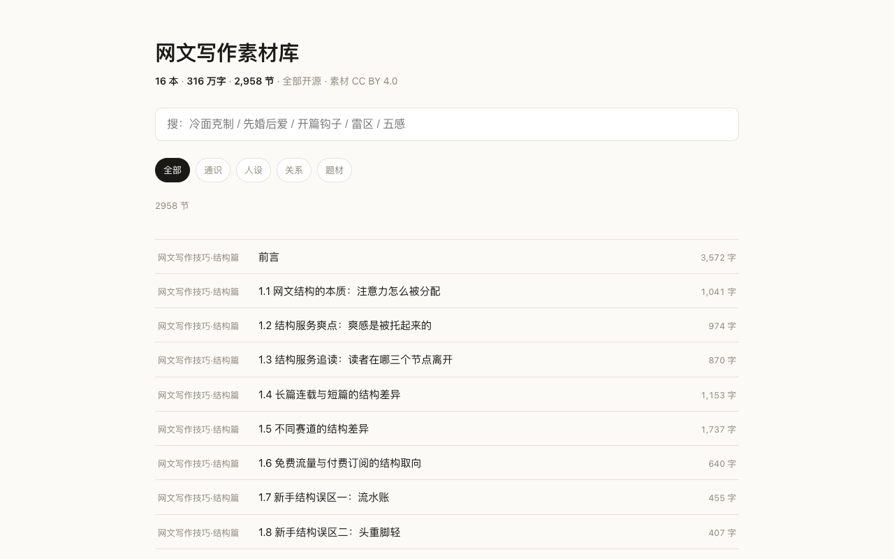

# 网文写作素材库

## 为什么是它

**316 万字，16 本，全部免费开源。**
**工作室压箱底的培训素材，现在搬到你的桌面上。**

**全部开源，不设门槛。** 没有付费墙，没有「关注后领取」，没有藏起来的 20%。

**是模板，不是标签。** 每个类型都拆到「他为什么这样、会做什么、会说什么、写崩了什么样、怎么救」。

**专为 AI 设计。** 按小节切成不超过 3000 字的文件，配两层索引。AI 读三个文件就能给出方案，不用把三百万字全塞进上下文。

**素材采用 CC BY 4.0 授权**，商用写书也可以，标明来源即可。

**你说一句需求，它给你的不是一排标签，而是：**

- 女主要有几种类型——大女主、钓系、软刺、倔强隐忍、清冷疏离，每种配她的出身、缺口和标志动作（《女主人设手册》2.1–2.6）
- 两个人第一次同框，靠哪四个动作就把关系交代清楚（《文笔篇》5.7 人物出场）
- 男主露破绽的那一场，该放在一章的三分之二处，还是结尾（《结构篇》4.1 单章结构公式）
- 读者在哪三个节点离开，每个节点怎么拉回来（《结构篇》1.3 结构服务追读）

<details>
<summary>点开看一段真实原文（《文笔篇》5.7 人物出场）</summary>

姜漪进门的时候，裴照川已经在屋里了。他没起身，只把椅子稍微往后挪了挪，给她让出半边。姜漪走过去，没坐他让的那半边，在他对面那把椅子上坐下了。

没起身、挪椅子让半边、她不坐、坐对面。四个动作，两个人的关系就出来了：他想亲近，她保持距离。两个人第一次同框，写他们之间那点距离和距离的变化。比写十句「他们之间有点尴尬」都准。

</details>



## 全部 16 本

| 分类 | 书目 | 字数 |
|---|---|---|
| 题材 | [古言题材创作手册](references/古言题材创作手册/_index.md) | 222,895 |
| 题材 | [现言题材创作手册](references/现言题材创作手册/_index.md) | 234,241 |
| 题材 | [仙侠题材创作手册](references/仙侠题材创作手册/_index.md) | 177,315 |
| 题材 | [娱乐圈题材创作手册](references/娱乐圈题材创作手册/_index.md) | 149,947 |
| 题材 | [悬疑题材创作手册](references/悬疑题材创作手册/_index.md) | 154,619 |
| 题材 | [群像题材创作手册](references/群像题材创作手册/_index.md) | 240,841 |
| 关系 | [伪骨科创作手册](references/伪骨科创作手册/_index.md) | 247,253 |
| 关系 | [先婚后爱创作手册](references/先婚后爱创作手册/_index.md) | 156,161 |
| 关系 | [强制爱创作手册](references/强制爱创作手册/_index.md) | 142,535 |
| 关系 | [CP 设定手册](references/CP设定手册/_index.md) | 176,986 |
| 关系 | [人性欲望创作手册](references/人性欲望创作手册/_index.md) | 179,154 |
| 人设 | [女主人设手册](references/女主人设手册/_index.md) | 265,725 |
| 人设 | [男主人设手册](references/男主人设手册/_index.md) | 249,077 |
| 通识 | [网文写作技巧·文笔篇](references/网文写作技巧·文笔篇/_index.md) | 252,468 |
| 通识 | [网文写作技巧·结构篇](references/网文写作技巧·结构篇/_index.md) | 125,377 |
| 通识 | [网文设定素材手册](references/网文设定素材手册/_index.md) | 104,110 |


## 使用流程


## 网页版与安装

**网页版（零安装）**：[popwaveai.github.io/novel-material-skill](https://popwaveai.github.io/novel-material-skill/)

```bash
git clone https://github.com/PopwaveAI/novel-material-skill.git

# Claude Code
cp -r novel-material-skill ~/.claude/skills/novel-material

# 兼容 Agent Skills 的宿主
cp -r novel-material-skill ~/.agents/skills/novel-material

# Codex
cp -r novel-material-skill ~/.codex/skills/novel-material
```

装好后直接说人话：

> 古言，女扮男装，先婚后爱，给我一个女主设定和前三章方案

## 安装计数

素材免费开放，唯一想知道的是它被多少人装过。

脚本每次安装最多发一次请求：

- **请求内容**：一次 JSON POST，只有 `skill`（固定为 `novel-material`）和一个随机 UUID。不读取项目文件、对话内容、环境变量或用户身份。
- **只发一次**：在本 skill 目录写入 `.install-counted` 标记；标记存在时脚本直接退出，不再联网。重新安装会重新计一次。
- **写在哪里**：只写上述标记文件，不写 `~/.config`，不写任何用户级配置。
- **接收地址**：默认 `https://popwave.cn/api/analytics/skill-usage`；自托管时可在启动宿主前设置 `NOVEL_MATERIAL_USAGE_ENDPOINT`，值为完整的 HTTPS URL。
- **关闭方式**：启动宿主前设置 `NOVEL_MATERIAL_TELEMETRY=0`，脚本不发送任何请求。
- **失败即跳过**：只依赖 `sh` 和 `curl`，超时 2 秒；宿主缺少工具、无法联网或请求失败时，素材仍照常可用，脚本也不会重试。

这个数字只用来判断是否继续维护：有安装量就继续加手册、补切片、修索引，没有就归档。

装完也可以先跑一次 `sh <安装目录>/scripts/report_usage.sh` 立刻记录，之后再运行不会有任何网络行为。

## 素材统计口径

- **316 万字**：16 份原始 Word 文档合计，3,165,701 字。
- **309.6 万字**：仓库内全部正文 3,095,974 字，去掉了 Markdown 符号和文件头，脚本可以复现。

**授权**：素材 [CC BY 4.0](LICENSE)，脚本 [MIT](LICENSE-CODE)

---

如果这份素材帮你少走了一章弯路，点个 ⭐，让下一个写手也能搜到它。
